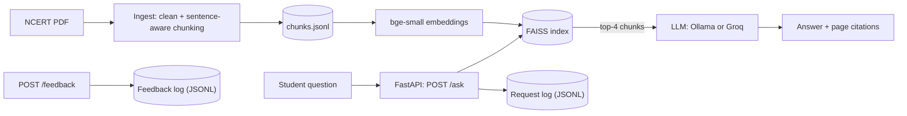
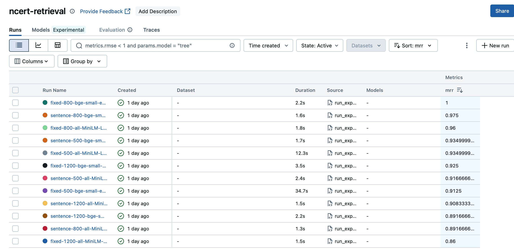

# NCERT Science Tutor: RAG Service with MLOps

[](https://github.com/MohammedSaba/ncert-rag-mlops/actions/workflows/ci.yml)

A retrieval-augmented question-answering service over NCERT Class 10 Science (currently Chapter 1). It answers **only from the textbook**, cites page numbers, and says "I couldn't find this in the textbook" when the answer isn't there.

The focus of this project is the engineering around the model: measured retrieval quality, experiment tracking, a containerized API, request logging, user feedback, and CI.

## Architecture



## What was measured

Retrieval was evaluated on a hand-built set of **20 questions** (a chunk counts as relevant if it contains the required evidence terms). I compared **12 configurations** (chunking strategy x chunk size x embedding model) and tracked every run in MLflow.



| Chunking | Size | Embedding | Hit@1 | Hit@3 | MRR |
|---|---|---|---|---|---|
| fixed | 800 | bge-small-en-v1.5 | 1.00 | 1.00 | 1.00 |
| **sentence** (chosen) | **800** | **bge-small-en-v1.5** | **0.95** | **1.00** | **0.97** |
| fixed | 800 | all-MiniLM-L6-v2 | 0.95 | 0.95 | 0.96 |
| sentence | 500 | bge-small-en-v1.5 | 0.90 | 0.95 | 0.93 |
| sentence | 800 | all-MiniLM-L6-v2 | 0.80 | 1.00 | 0.89 |
| fixed | 1200 | all-MiniLM-L6-v2 | 0.75 | 0.95 | 0.86 |

(Top, chosen, and bottom rows shown; all 12 runs are in MLflow.)

**Findings**
- **bge-small beat MiniLM** at the same chunking (sentence-800 MRR: 0.89 to 0.97).
- **Sentence-aware vs fixed-size chunking was a statistical tie** on this eval (the gap is one question out of 20). I chose sentence-aware chunking because whole-sentence chunks give cleaner context and citations to the LLM, not because the numbers separate them.
- Very large chunks (1200) hurt Hit@1 for both strategies.

## Run it

```bash
# 1. Setup
python -m venv venv && source venv/bin/activate
pip install -r requirements.txt

# 2. Add the textbook (not committed): download Class 10 Science, Chapter 1
#    from ncert.nic.in and save it as data/science10.pdf

# 3. Build chunks and the index
python -m scripts.ingest --strategy sentence --chunk_size 800
python -m scripts.build_index

# 4. Configure the LLM (any OpenAI-compatible endpoint)
#    .env  (never commit this file)
#    LLM_BASE_URL=http://localhost:11434/v1     # Ollama locally
#    LLM_API_KEY=ollama
#    LLM_MODEL=llama3:latest

# 5. Serve
uvicorn app.main:app --port 8000
# open http://127.0.0.1:8000/docs
```

**Switch to a hosted LLM** by changing only the three variables above (for example Groq: `https://api.groq.com/openai/v1`, your key, and a model name from Groq's model list). No code change.

### Docker

```bash
docker build -t ncert-rag .
docker run --rm -p 8000:8000 --env-file .env.docker \
  -v "$(pwd)/logs:/app/logs" ncert-rag
```

The image uses CPU-only PyTorch and bakes in the embedding model so startup needs no download. The index is rebuilt from `data/chunks.jsonl` at startup if it is missing.

## API

| Endpoint | Purpose |
|---|---|
| `POST /ask` | `{"question": "..."}` returns the answer, source pages with similarity scores, token count, latency and a `request_id` |
| `POST /feedback` | `{"request_id": "...", "helpful": true, "comment": "..."}` records thumbs up/down |
| `GET /health` | Liveness check and number of indexed chunks |

Every request and every feedback entry is appended as one JSON line under `logs/` (question, answer, retrieved pages, top similarity score, latency, errors), so quality can be reviewed later.

## Experiments and CI

```bash
python -m scripts.run_experiments   # runs all 12 configs, logs to MLflow
mlflow ui                           # http://127.0.0.1:5000
python -m scripts.check_eval        # validates the eval set against the chunks
```

GitHub Actions (`.github/workflows/ci.yml`) runs on every push:
1. Unit tests for the chunker (`pytest`)
2. A **retrieval-quality gate** (`scripts/eval_gate.py`) that fails the build if Hit@3 drops below 0.90
3. A Docker image build

## Project layout

```
app/        chunking, retrieval, RAG answering, FastAPI service
scripts/    ingest, build_index, ask, run_experiments, check_eval, eval_gate
tests/      chunking tests
data/       chunks.jsonl, eval.jsonl
Dockerfile  requirements.txt (dev)  requirements-serve.txt (runtime)
```

## Limitations

- **One chapter only.** The corpus is Chapter 1 of Class 10 Science; more chapters need a re-ingest.
- **Small eval set.** 20 questions with keyword-based relevance is a proxy for human judgments. Several configs hit 1.00 at Hit@3, so the set can no longer separate them; it needs more and harder questions.
- **Answer quality is not automatically scored.** Only retrieval is measured; generated answers are spot-checked by hand.
- **Not currently hosted.** It runs locally and in Docker. Running a local LLM on CPU is slow (tens of seconds per answer); a hosted LLM endpoint is much faster.

## Next steps

- Add more chapters and a larger, harder eval set
- Score answer faithfulness (not just retrieval)
- Minimal web UI and a hosted demo
- Use the logged feedback to find failing questions
